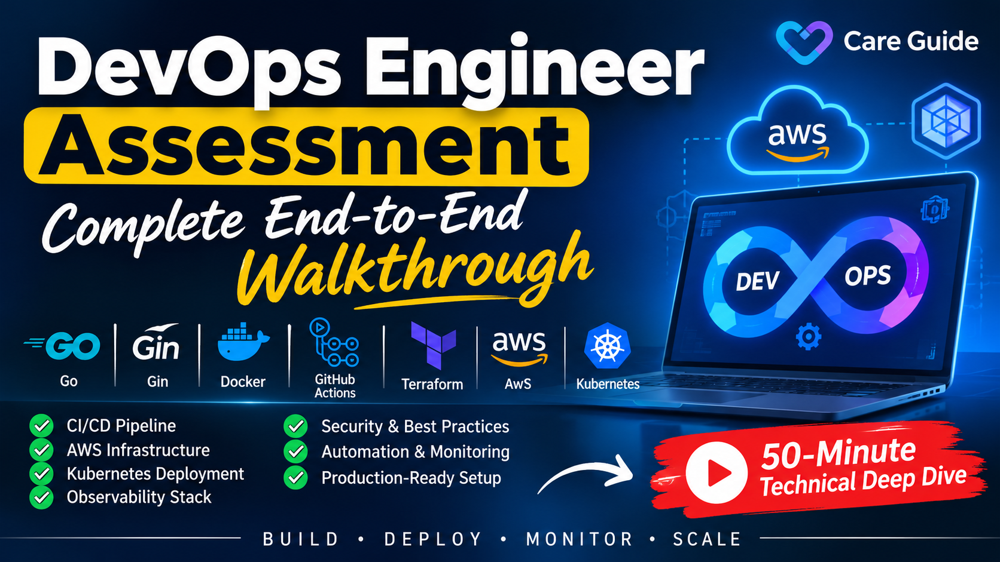
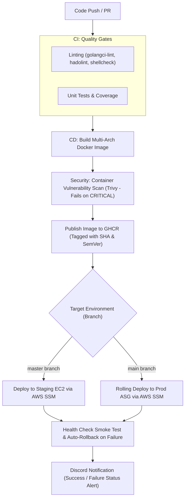
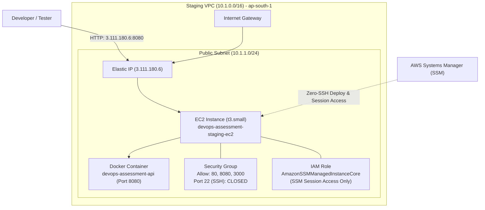
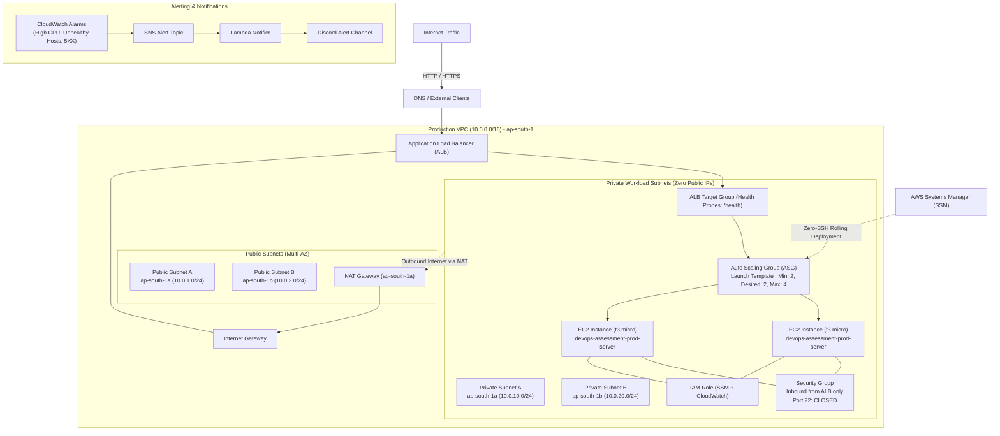
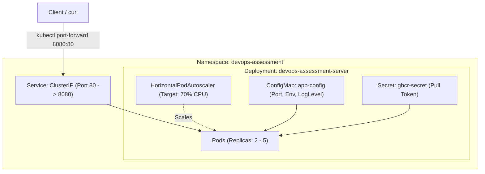
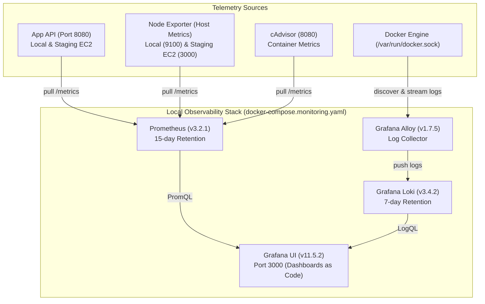
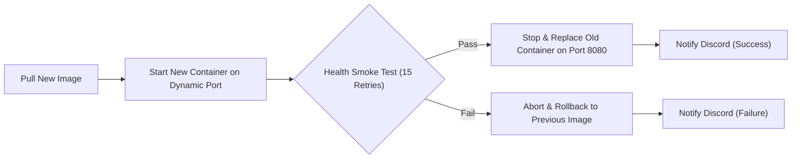

# DevOps Assessment - Production Web Service & Platform

End-to-end, production-ready DevOps implementation for building, shipping, orchestrating, and observing a resilient web service across local Docker Compose, Kubernetes, and AWS infrastructure provisioned via Terraform.

> 📺 **Complete Video Walkthrough & Architectural Deep-Dive:**
> A comprehensive video walkthrough explaining the entire repository from top to bottom—covering Docker hardening, CI/CD with SSM zero-downtime deploys, Terraform dual-VPC architecture, Minikube Kubernetes manifests, Prometheus/Grafana observability, and the Linux automation script:
>
> [](https://youtu.be/dCzHTVFT8d4)  
> _(Click above to watch the full project walkthrough video)_

---

## Table of Contents

- [Initialization - Git Branching & Deployment Strategy](#initialization--git-branching--deployment-strategy)
- [Step 1: Application & Containerization](#step-1-application--containerization)
- [Step 2: CI/CD Pipeline (GitHub Actions)](#step-2-cicd-pipeline-github-actions)
- [Step 3: Infrastructure as Code (Terraform)](#step-3-infrastructure-as-code-terraform)
- [Step 4: Kubernetes Deployment](#step-4-kubernetes-deployment)
- [Step 5: Observability Stack](#step-5-observability-stack)
- [Step 6: Linux Automation Scripting](#step-6-linux-automation-scripting)
- [Design Decisions & Trade-Offs](#design-decisions--trade-offs)
- [Deployment & Rollback Strategy](#deployment--rollback-strategy)
- [Security Considerations](#security-considerations)
- [AWS Production Cost Estimation](#aws-production-cost-estimation)
- [Bonus Capabilities & What I Would Improve With More Time](#bonus-capabilities--what-i-would-improve-with-more-time)
- [AI Tool Usage Disclosure](#ai-tool-usage-disclosure)
- [Conclusion](#conclusion)

---

## Initialization - Git Branching & Deployment Strategy

- **`master` (Staging Environment):** Merges into `master` automatically trigger a zero-downtime deployment to the AWS Staging environment (`http://3.111.180.6:8080`).
- **`main` (Production Environment):** Merges into `main` trigger a zero-downtime rolling deployment to the AWS Production environment (`http://devops-assessment-prod-alb-2108406691.ap-south-1.elb.amazonaws.com`).

Both deployment pipelines enforce strict pre-flight quality and security gates—including code linting (`golangci-lint`), shell scripting linting (`shellcheck`), Dockerfile validation (`hadolint`), automated unit testing with coverage, and container vulnerability scanning (`Trivy` failing on `CRITICAL`)—prior to releasing zero-downtime updates via AWS Systems Manager (SSM).

## Step 1: Application & Containerization

A lightweight Go backend server built with the **Gin** framework serving three core endpoints:

- `GET /`: Returns service metadata `{"message": "Hello from DevOps Task!", "status": "running", "version": "1.0.0"}`.
- `GET /health`: Liveness and readiness health probe returning `{"status": "ok"}`.
- `GET /metrics`: Exposes Prometheus-formatted metrics including request count (`http_requests_total`), error count (`http_requests_errors_total`), and latency histogram (`http_request_duration_seconds`).

### Multi-Stage Docker Build & Security Hardening

- Built using a multi-stage `Dockerfile` (`golang:1.27-alpine` builder $\rightarrow$ `alpine:3.21` runtime) to produce a minimal, production-grade image:
  - **Final Image Size:** **34.8 MB** disk usage (compressed download size: **9.86 MB**).
- Runs strictly as an unprivileged non-root user (`appuser:10001`) with a read-only root filesystem, dropped capabilities (`cap-drop: ALL`), and `no-new-privileges:true` to ensure container escape protection and isolate the host machine.

### Local Development

Run the containerized application locally with defined CPU (0.50) and memory (128 MB) limits using `docker-compose.yaml`:

```bash
docker compose up -d --build
```

## Step 2: CI/CD Pipeline (GitHub Actions)



### Environment-Based Deployment & Security

- **Branch-Based Target Resolution:** The workflow dynamically routes deployments based on the branch reference:
  - `master` $\rightarrow$ deploys to the standalone **Staging** instance.
  - `main` $\rightarrow$ initiates a zero-downtime rolling update across the **Production** Auto Scaling Group behind the ALB.
- **Docker Image Vulnerability Scanning:** Every container image is scanned by **Trivy** before being pushed to GHCR. Any detected `CRITICAL` vulnerability halts the pipeline immediately.
- **Agent-Based Deployment via AWS SSM:** Zero SSH exposure. Port 22 is entirely closed on all EC2 security groups. Commands and rolling container swaps are executed securely over the AWS Systems Manager (SSM) agent session.
- **Zero Hardcoded Secrets:** All credentials (`AWS_ACCESS_KEY_ID`, `AWS_SECRET_ACCESS_KEY`, `GHCR_TOKEN`, `DISCORD_WEBHOOK_URL`) are injected at runtime via GitHub Actions encrypted secrets.
- **Automated Rollback & Real-Time Alerts:** Pre-swap `/health` checks verify new containers before traffic switchover; failed deployments revert to the previous image tag automatically and dispatch instant failure alerts to **Discord**. Successful production and staging rollouts trigger success summaries with image metadata.

## Step 3: Infrastructure as Code (Terraform)

### 1. Terraform Remote State Bootstrap Architecture

```mermaid
flowchart TD
    DevOpsEng["DevOps Engineer / CI Runner"] -->|"terraform apply (terraform/bootstrap)"| BootstrapModule["Terraform Bootstrap Engine"]

    subgraph BootstrapInfra ["AWS S3 & DynamoDB Remote State Backend (ap-south-1)"]
        subgraph StagingBackend ["Staging State Store"]
            S3_Staging["S3 Bucket: devops-assessment-staging-tfstate-1<br>• Versioning: Enabled<br>• Encryption: AES256 (SSE-S3)<br>• Public Access: Blocked"]
            DDB_Staging["DynamoDB Table: devops-assessment-staging-tflocks<br>• Partition Key: LockID (String)<br>• Prevents Concurrent Applies"]
        end

        subgraph ProdBackend ["Production State Store"]
            S3_Prod["S3 Bucket: devops-assessment-prod-tfstate-1<br>• Versioning: Enabled<br>• Encryption: AES256 (SSE-S3)<br>• Public Access: Blocked"]
            DDB_Prod["DynamoDB Table: devops-assessment-prod-tflocks<br>• Partition Key: LockID (String)<br>• Prevents Concurrent Applies"]
        end
    end

    BootstrapModule --> StagingBackend
    BootstrapModule --> ProdBackend

    StagingBackend -.->|"State Locking & Storage"| StagingTerraform["terraform/environments/staging"]
    ProdBackend -.->|"State Locking & Storage"| ProdTerraform["terraform/environments/prod"]
```



---

### 2. Staging Infrastructure Architecture (Cost-Effective & Isolated)



---

### 3. Production Infrastructure Architecture (Multi-AZ High Availability)



### Architecture & Network Isolation

- **Dedicated Dual VPCs:** Staging (`10.1.0.0/16`) and Production (`10.0.0.0/16`) are fully segregated with zero network peering, ensuring complete environment isolation.
- **Production High Availability:** Spans 2 Availability Zones (`ap-south-1a`, `ap-south-1b`) with public/private subnet topology. Workloads run inside private subnets behind an Application Load Balancer with outbound internet provided via NAT Gateway.
- **Lightweight Staging:** Cost-effective single-instance setup (`t3.small`) bound to a static Elastic IP for straightforward validation without ALB/NAT overhead.
- **IAM Least Privilege & Zero SSH:** No static IAM credentials exist on instances. All access is governed via AWS Systems Manager (`AmazonSSMManagedInstanceCore`). CloudWatch logging and alarms are strictly provisioned on Production (`prod`), keeping Staging lean without extra agent overhead. Port 22 is disabled across all security groups.
- **State Management:** S3 remote backends with AES-256 encryption, bucket versioning, and DynamoDB-backed state locking to prevent concurrent modifications.

### Evidence of Plan & Apply

Execution logs and verification outputs are archived in `screenshots/terraform/`:

- [`screenshots/terraform/staging-plan.png`](screenshots/terraform/staging-plan.png) — Staging resource execution plan
- [`screenshots/terraform/staging-apply.png`](screenshots/terraform/staging-apply.png) — Staging resources successfully provisioned
- [`screenshots/terraform/prod-plan.png`](screenshots/terraform/prod-plan.png) — Production resource execution plan
- [`screenshots/terraform/prod-apply.png`](screenshots/terraform/prod-apply.png) — Production multi-AZ resources successfully provisioned

---

## Step 4: Kubernetes Deployment

Local Kubernetes architecture deployed on **Minikube** under the isolated `devops-assessment` namespace.



### Manifest Specifications (`k8s/`)

- **`deployment.yaml`:**
  - High availability: Min 2 replicas with `RollingUpdate` strategy (`maxSurge: 1`, `maxUnavailable: 0`).
  - Container hardening: `runAsNonRoot: true` (`UID/GID 10001`), `readOnlyRootFilesystem: true`, capabilities dropped (`ALL`), `allowPrivilegeEscalation: false`.
  - Resource governance: Requests (`50m` CPU, `64Mi` RAM) and Limits (`250m` CPU, `128Mi` RAM).
  - Health probes: Liveness (`/health`, 10s period) and Readiness (`/health`, 5s period).
- **`service.yaml`:** Exposes backend pods internally via `ClusterIP` on port 80.
- **`hpa.yaml`:** `HorizontalPodAutoscaler` scaling from 2 to 5 pods when average CPU utilization exceeds 70%.
- **`configmap.yaml` & `dotenv-secret.yaml`:** Decoupled runtime configuration (`app-config`) and Git-ignored image pull credentials (`ghcr-secret` from `dotenv-secret.yaml.example`).

---

### Local Deployment & Access via Port-Forwarding

```bash
# 0. Start Minikube & enable metrics-server for HPA
minikube start
minikube addons enable metrics-server

# 1. Create namespace, config, and secret
kubectl apply -f k8s/namespace.yaml
kubectl apply -f k8s/configmap.yaml

# Generate image pull secret from template (copy dotenv-secret.yaml.example -> dotenv-secret.yaml)
kubectl apply -f k8s/dotenv-secret.yaml

# 2. Deploy application and HPA
kubectl apply -f k8s/deployment.yaml
kubectl apply -f k8s/service.yaml
kubectl apply -f k8s/hpa.yaml

# 3. Access locally via Port-Forwarding
kubectl port-forward -n devops-assessment svc/devops-assessment-service 8080:80
```

Verify service in another terminal:

```bash
curl -s http://localhost:8080/
# {"message":"Hello from DevOps Task!","status":"running","version":"1.0.0"}

curl -s http://localhost:8080/health
# {"status":"ok"}
```

#### Evidence of Running Workload

- [`screenshots/k8s/get-all.png`](screenshots/k8s/get-all.png) — Verified cluster state showing active Pods, Service, Deployment, and HPA in Minikube (`kubectl get all -n devops-assessment`).

---

### Zero-Downtime Rolling Update & Rollback Verification

```bash
# Trigger rolling update to new image version
kubectl set image deployment/devops-assessment-server server=ghcr.io/devlopersabbir/devops-assessment:1.1.0 -n devops-assessment

# Monitor zero-downtime rollout in real time
kubectl rollout status deployment/devops-assessment-server -n devops-assessment
# Output: deployment "devops-assessment-server" successfully rolled out

# Verify rollout history
kubectl rollout history deployment/devops-assessment-server -n devops-assessment

# Instant rollback to the previous working revision if an issue occurs
kubectl rollout undo deployment/devops-assessment-server -n devops-assessment
# Output: deployment.apps/devops-assessment-server rolled back
```

---

### Production EKS Transition (What Would Change)

To migrate this local Minikube setup to a real Amazon EKS cluster:

6. **Ingress & HTTPS:** Replace manual `port-forwarding` with an **Application Load Balancer (ALB)** and an SSL/TLS certificate for secure HTTPS domain traffic.
7. **Secrets Storage:** Store sensitive tokens in **AWS Secrets Manager** instead of local YAML files.
8. **Pod IAM Permissions:** Attach IAM roles directly to Kubernetes service accounts so pods can access AWS resources without static credentials.
9. **Cluster Autoscaling:** Enable a standard **Cluster Autoscaler** so worker nodes automatically scale up when more pods are created by the HPA.

---

## Step 5: Observability Stack

The observability architecture integrates **Prometheus, Grafana, Loki, Grafana Alloy, Node Exporter, and cAdvisor**. All six components are provisioned as code and run locally via `docker-compose.monitoring.yaml`, with Prometheus also scraping the live AWS Staging instance.



---

### Local Observability Quickstart

```bash
# 1. Start all 6 monitoring components in background
docker compose -f docker-compose.monitoring.yaml up -d

# 2. Access Grafana UI in your browser
# URL: http://localhost:3000
# Default Credentials: admin / AdminSecurePass123! (Configurable via .env)
```

> **AWS Staging Telemetry Note:** To preserve resources on the `t3.small` instance (2 GB RAM), heavy logging and dashboard services remain local. Staging EC2 runs solely `prom/node-exporter:v1.9.0` (port `3000`), allowing local Prometheus to stream real-time cloud hardware metrics alongside local workloads.

---

### Metrics & Log Collection Strategy

1. **Prometheus Metrics (15-Day Retention):**
   - Configured with `--storage.tsdb.retention.time=15d`.
   - Scrapes local and Staging API (`http://3.111.180.6:8080/metrics`).
   - Scrapes host metrics from local Node Exporter and live AWS Staging EC2 (`http://3.111.180.6:3000/metrics`).
   - Scrapes container metrics from cAdvisor.
2. **Log Collection with Grafana Alloy & Loki (7-Day Retention):**
   - Loki enforces a 7-day retention period (`retention_period: 168h`) with a filesystem delete-request store.
   - **Label Cardinality Hygiene:** Alloy extracts structured JSON logs from stdout. It promotes only low-cardinality fields (`level`: `info`, `warn`, `error`) to indexed labels. High-cardinality values (`path`, `status`, `latency`) remain in structured metadata to prevent memory exhaustion and index explosion.

---

### Dashboards Provisioned as Code (`monitoring/grafana/dashboards/`)

Data sources and dashboards are loaded automatically on startup without manual UI setup:

1. **Application Dashboard (`application.json`):**
   - Real-time HTTP request rate (`rate(http_requests_total[1m])`).
   - Error rate percentage (4xx and 5xx).
   - Latency distribution Gauges and Timeseries (p50, p95, p99 via `histogram_quantile`).
   - **Co-Located Loki Logs Panel:** Live container logs displayed below metrics for instant incident correlation.
2. **Host Dashboard (`host.json`):**
   - CPU utilization (overall and per-core).
   - Memory breakdown (Total, Used, Cached, Free).
   - Root disk filesystem usage and network throughput (RX/TX).
   - Supports toggle between `local` and `staging-ec2-t3small`.

#### Dashboard Evidence

- [`screenshots/monitoring/dashboard-application.png`](screenshots/monitoring/dashboard-application.png) — Application metrics & co-located logs view.
- [`screenshots/monitoring/dashboard-host.png`](screenshots/monitoring/dashboard-host.png) — Staging EC2 host hardware & resource utilization view.

---

### Alerting Rules (`monitoring/prometheus/alerts/alert_rules.yml`)

Prometheus evaluates four core production alerting rules:

| Alert Name                     | Expression & Threshold                      | Duration (`for`) | Severity | Justification                                                                  |
| :----------------------------- | :------------------------------------------ | :--------------- | :------- | :----------------------------------------------------------------------------- |
| **`AppInstanceDown`**          | `up{job="devops-api"} == 0`                 | `1m`             | Critical | Immediate alert when an application instance stops responding to probes.       |
| **`HighErrorRate`**            | Rate of 5xx errors $> 5\%$ of total traffic | `2m`             | Critical | Identifies server-side regressions while filtering transient network blips.    |
| **`HostDiskUsageHigh`**        | Filesystem storage $> 80\%$                 | `5m`             | Warning  | Proactive notification before disk exhaustion causes container write failures. |
| **`ContainerMemoryNearLimit`** | Memory usage $> 85\%$ of limit              | `2m`             | Warning  | Detects memory leaks or undersized limits prior to kernel OOM kills.           |

---

### Security & Runtime Hygiene

- **Minimal Exposure:** Only Grafana port `3000` is published to the host. Prometheus, Loki, Alloy, Node Exporter, and cAdvisor communicate strictly over the internal Docker network `monitoring_network`.
- **Credential Governance:** Admin user and password are fed via environment variables (`GF_SECURITY_ADMIN_USER`, `GF_SECURITY_ADMIN_PASSWORD`).
- **Host Mount Privileges:**
  - `node-exporter` mounts `/proc`, `/sys`, and `/rootfs:ro` read-only to capture kernel OS metrics.
  - `cadvisor` requires access to `/var/run/docker.sock:ro` and `/sys:ro` to query Docker cgroups.
  - `alloy` mounts `/var/run/docker.sock:ro` solely to discover container IDs and read stdout log streams.

---

### Incident Walkthrough

**Scenario: An error spike appears on the Application dashboard. How do you find the cause using these tools?**

1. **Detection (Application Dashboard):**
   The _Error Rate (%)_ panel spikes above 5%, triggering the `HighErrorRate` Prometheus alert. The p99 latency panel simultaneously displays an upward jump.
2. **Correlation (Co-Located Loki Logs Panel):**
   Without leaving the Application dashboard, inspect the bottom **Loki Logs** panel filtered by `{service="api"} |= "level=ERROR"` or status $\ge 500$ during the exact timestamp of the spike.
3. **Root Cause Analysis:**
   Inspect the structured JSON log entry:
   ```json
   {
     "timestamp": "2026-11-17T00:30:15Z",
     "level": "ERROR",
     "method": "GET",
     "path": "/panic",
     "status": 500,
     "latency_ms": 12.4,
     "message": "Panic recovered on GET /panic: simulated unexpected panic"
   }
   ```
   The stack trace and path (`/panic`) pinpoint the exact failed endpoint and runtime exception.
4. **Host & Container Cross-Check (Host Dashboard):**
   Check the **Host Dashboard** to rule out host-level memory exhaustion, CPU throttling, or disk full conditions. If host resources are normal, the issue is confirmed as application-layer bug rather than infrastructure degradation.

---

## Step 6: Linux Automation Scripting

A production-grade, POSIX-compliant Bash health reporter ([scripts/system_health.sh](scripts/system_health.sh)) engineered for Linux servers.

### Core Capabilities

1. **Telemetry Collection:**
   - **CPU Usage:** Total percentage calculated from `/proc/stat`.
   - **Memory Usage:** Used vs. Total memory calculated from `/proc/meminfo`.
   - **Disk Filesystems:** Reports usage across all physical mounted filesystems (excluding `tmpfs`, `devtmpfs`, `squashfs`).
   - **System Load Averages:** 1-minute, 5-minute, and 15-minute load averages from `/proc/loadavg`.
   - **Top 5 Memory Consumers:** Process names, PIDs, user, and RSS memory usage via `ps`.
2. **Standardized Exit Codes for Monitoring Tools:**
   - `0`: **Healthy** — all metrics below warning thresholds.
   - `1`: **Warning** — one or more metrics exceeded warning thresholds.
   - `2`: **Critical** — one or more metrics exceeded critical thresholds.
3. **Structured JSON & Plaintext Logging:**
   - Appends timestamped logs to `health_log.txt`.
   - Pass `--json` to output newline-delimited structured JSON for ingestion by log shippers.
4. **Log Rotation:**
   - Automatic size-based rotation when the log file exceeds **1 MB** (`MAX_LOG_SIZE_KB=1024`).
   - Retains 3 historical rotated archives (`health_log.txt.1`, `.2`, `.3`).
5. **Quality & Portability:**
   - Strict execution safety: `set -euo pipefail`.
   - Passed `shellcheck` with zero warnings.
   - Fully documented CLI options with `--help`.

---

### CLI Usage & Examples

```bash
# Display help and available flags
./scripts/system_health.sh --help

# Run standard health check with default thresholds (80% warn / 90% crit)
./scripts/system_health.sh

# Run with custom thresholds and output structured JSON
./scripts/system_health.sh --cpu 75 --mem 80 --disk 85 --json
```

#### Sample JSON Output (`--json`)

```json
{
  "timestamp": "2026-11-17T00:50:00Z",
  "status": "HEALTHY",
  "exit_code": 0,
  "metrics": {
    "cpu_usage_percent": 1.85,
    "mem_usage_percent": 21.4,
    "load_average": { "1m": 0.05, "5m": 0.08, "15m": 0.02 },
    "disks": [
      { "filesystem": "/dev/nvme0n1p1", "mount": "/", "used_percent": 8.2 }
    ],
    "top_5_processes_by_memory": [
      { "pid": 1120, "user": "root", "mem_percent": 2.1, "cmd": "/app/server" },
      {
        "pid": 2840,
        "user": "root",
        "mem_percent": 1.2,
        "cmd": "/bin/node_exporter"
      }
    ]
  }
}
```

---

### Scheduled Automation (Every 5 Minutes)

#### Option 1: systemd Service & Timer (Recommended for Production)

Unit files are provided under [scripts/systemd/](scripts/systemd/):

```bash
# Copy unit files to systemd directory
sudo cp scripts/systemd/system-health.service /etc/systemd/system/
sudo cp scripts/systemd/system-health.timer /etc/systemd/system/

# Reload systemd daemon and enable timer
sudo systemctl daemon-reload
sudo systemctl enable --now system-health.timer

# Verify timer execution schedule
systemctl list-timers system-health.timer
```

#### Option 2: Cron Job Entry

A standard cron configuration is provided in [scripts/system_health.cron](scripts/system_health.cron):

```bash
# Install cron entry to run every 5 minutes
sudo cp scripts/system_health.cron /etc/cron.d/system_health
sudo chmod 0644 /etc/cron.d/system_health
```

Cron expression:

```cron
*/5 * * * * root /usr/local/bin/system_health.sh --log-file /var/log/health_log.txt >/dev/null 2>&1
```

---

## Design Decisions & Trade-Offs

### 1. Distroless vs. Alpine 3.21

- **Decision:** Selected `alpine:3.21` over Google Distroless for the production runtime stage.
- **Trade-Off Analysis:** While Distroless eliminates the package manager and shell entirely, Alpine provides an exceptionally small footprint (**34.8 MB** uncompressed / **9.86 MB** compressed) while retaining native tools (`wget`, `sh`) required for Docker container `HEALTHCHECK` instructions and Alpine's latest CVE security patches. Hardening is enforced by running as an unprivileged user (`10001`), dropping all Linux capabilities, and mounting the root filesystem as read-only.

### 2. EC2 vs. ECS vs. EKS

- **Decision:** Implemented EC2 Auto Scaling Groups behind an Application Load Balancer for the core AWS deployment, complemented by a complete Kubernetes manifest suite for Minikube.
- **Trade-Off Analysis:** Managed container services (ECS/EKS) reduce host maintenance overhead. However, bare-metal EC2 with AWS Systems Manager (SSM) demonstrates low-level systems engineering, zero-downtime container swaps, and custom host observability while keeping operational costs within AWS Free Tier limits.

### 3. Tagging & Versioning Strategy

- **Decision:** Images are strictly tagged with the short Git commit SHA (`sha-<commit>`) and semantic versions (`vX.Y.Z`).
- **Trade-Off Analysis:** Avoiding mutable `latest` tags guarantees deterministic, immutable deployments. Every running container can be audited back to the exact Git commit that produced it, and rollbacks are 100% reliable.

### 4. Secrets Management

- **Decision:** Zero plain-text credentials in the repository.
- **Trade-Off Analysis:** GitHub Encrypted Secrets supply pipeline tokens (`GHCR_TOKEN`, AWS credentials). AWS instances rely entirely on IAM Instance Profiles (`AmazonSSMManagedInstanceCore`), eliminating long-lived access keys and credential rotation risks on the host.

### 5. Log Label Cardinality Hygiene

- **Decision:** Only low-cardinality metadata (`level`: `info`, `warn`, `error`) is indexed as Loki labels in Grafana Alloy.
- **Trade-Off Analysis:** High-cardinality fields such as IP addresses, exact latency timestamps, and request paths are stored inside structured JSON payloads and extracted at query time via LogQL (`json`). This prevents label cardinality explosion and keeps Loki memory usage minimal.

---

## Deployment & Rollback Strategy



1. **Zero-Downtime Deployment Flow:**
   - Deployments execute via **AWS Systems Manager (SSM)** without requiring open inbound SSH ports.
   - The runner launches the newly published image alongside the active container on a dynamic port.
   - A health loop queries `http://<container-ip>:8080/health` up to 15 times (30 seconds maximum).
   - Once healthy, the old container is gracefully terminated and the new container takes over port `8080`.
2. **Automated Rollback Mechanism:**
   - If the new container fails its health checks, the script immediately aborts the rollout, removes the failing container, keeps the previous working container active, and logs the error to **Discord**.
   - In Kubernetes, instant rollback is achieved via `kubectl rollout undo deployment/devops-assessment-server`.

---

## Security Considerations

| Security Layer              | Implementation & Controls                                                                                                                                                                      |
| :-------------------------- | :--------------------------------------------------------------------------------------------------------------------------------------------------------------------------------------------- |
| **Container Hardening**     | Runs as non-root (`UID 10001`), read-only root filesystem (`read_only: true`), Linux capabilities dropped (`cap_drop: ALL`), and `no-new-privileges: true`.                                    |
| **Pipeline Security Gates** | `hadolint` for Dockerfile best practices, `shellcheck` for shell scripts, `golangci-lint` for Go static analysis, and **Trivy** scanning images to block builds on `CRITICAL` vulnerabilities. |
| **Network Isolation**       | Port 22 (SSH) is completely closed across all security groups. Management is conducted securely via AWS SSM. Production workloads are isolated in private subnets with no public IPs.          |
| **IAM Least Privilege**     | Instances utilize IAM Instance Profiles limited strictly to `AmazonSSMManagedInstanceCore`. Zero static access keys are generated or stored on virtual machines.                               |

---

## AWS Production Cost Estimation

Estimated monthly infrastructure cost for the production environment hosted in AWS region `ap-south-1` (Mumbai):

| Service Component             | Configuration / Specification                             | Estimated Monthly Cost (USD)   |
| :---------------------------- | :-------------------------------------------------------- | :----------------------------- |
| **EC2 Compute**               | 2x `t3.micro` instances (Production ASG, 24/7)            | ~$15.20 _(Free Tier eligible)_ |
| **Staging EC2**               | 1x `t3.small` instance (2 vCPU, 2 GB RAM)                 | ~$15.18                        |
| **Application Load Balancer** | 1x Internet-facing ALB (~15 LCU-hours/month)              | ~$18.25                        |
| **NAT Gateway**               | 1x NAT Gateway in Public Subnet + 5 GB data processed     | ~$34.50                        |
| **EBS Storage**               | 3x 20 GB gp3 encrypted root volumes (60 GB total)         | ~$4.80                         |
| **CloudWatch & Logs**         | Metrics alarms, dashboard, and log ingestion (under 5 GB) | ~$3.00                         |
| **S3 & DynamoDB**             | Remote state storage and state locking tables             | ~$0.25                         |
| **Total Estimated Cost**      | **Production & Staging Infrastructure**                   | **~$88 – $91 / month**         |

> _Cost Optimization Tip:_ In pre-production, removing the NAT Gateway and running workloads in public subnets with direct Internet Gateways reduces monthly expenditure by ~$35/month.

---

## Bonus Capabilities & What I Would Improve With More Time

### Bonus Capabilities Implemented

- **Automated Discord Alerts:** Real-time notifications for GitHub Actions deployment results and CloudWatch alarm triggers.
- **Automated Log Rotation:** Size-based log rotation and exit code standards built directly into `system_health.sh`.
- **Zero-Downtime Rolling Deploys:** Container swapping with automatic rollback on healthcheck failure.

### What I Would Improve With More Time

5. **Helm Chart Packaging:** Package the `k8s/` manifests into a single Helm chart with separate `values-staging.yaml` and `values-prod.yaml` files.
6. **HTTPS & Custom Domain:** Add a custom domain and an ACM SSL certificate to the Application Load Balancer.
7. **Alertmanager Webhooks:** Connect Prometheus Alertmanager directly to Discord or Slack channels for immediate threshold alerts.
8. **Database Integration:** Connect a managed PostgreSQL (RDS) instance to the Go API with automated schema migration scripts.

---

## AI Tool Usage Disclosure

Generative AI assistance (Google Antigravity / Gemini) was utilized during this assessment as an engineering productivity accelerator for:

- Formulating initial boilerplate scaffolding for GitHub Actions workflows and Terraform modules.
- Troubleshooting shell quoting edge cases within nested inline JQ expressions.
- Cross-verifying Prometheus PromQL syntax against Node Exporter metric schemas.

All architectural decisions, container hardening configurations, network designs, and script implementations were reviewed, verified, tested, and validated end-to-end to ensure production reliability and adherence to industry best practices.

---

## Conclusion

This project demonstrates a production-grade DevOps lifecycle: from a secure, containerized Go service to automated GitHub Actions CI/CD with zero-downtime SSM deployments, robust Terraform infrastructure provisioning across dedicated VPCs, resilient Kubernetes manifests on Minikube, a full 6-component observability stack, and Linux automation scripting.
