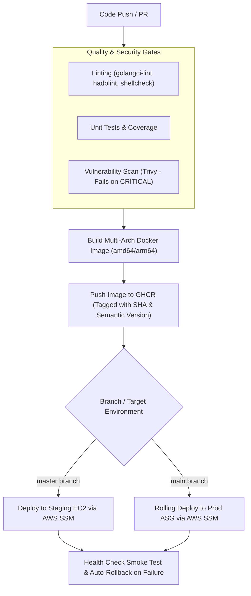

# DevOps Assessment - Production Web Service & Platform

End-to-end, production-ready DevOps implementation for building, shipping, orchestrating, and observing a resilient web service across local Docker Compose, Kubernetes, and AWS infrastructure provisioned via Terraform.

---

## Table of Contents

- [Initialization - Git Branching & Deployment Strategy](#initialization--git-branching--deployment-strategy)
- [Step 1: Application & Containerization](#step-1-application--containerization)
- [Step 2: CI/CD Pipeline (GitHub Actions)](#step-2-cicd-pipeline-github-actions)
- [Step 3: Infrastructure as Code (Terraform)](#step-3-infrastructure-as-code-terraform)
- [Step 4: Kubernetes Deployment](#step-4-kubernetes-deployment)
- [Step 5: Observability Stack](#step-5-observability-stack)
- [Step 6: Linux Automation Scripting](#step-6-linux-automation-scripting)
- [Design Decisions & Trade-Offs](#design-decisions--trade-offs)
- [Deployment & Rollback Strategy](#deployment--rollback-strategy)
- [Security Considerations](#security-considerations)
- [AWS Production Cost Estimation](#aws-production-cost-estimation)
- [What I Would Improve With More Time](#what-i-would-improve-with-more-time)
- [AI Tool Usage Disclosure](#ai-tool-usage-disclosure)

---

## Initialization - Git Branching & Deployment Strategy

- **`master` (Staging Environment):** Merges into `master` automatically trigger a zero-downtime deployment to the AWS Staging environment (`http://3.111.180.6:8080`).
- **`main` (Production Environment):** Merges into `main` trigger a zero-downtime rolling deployment to the AWS Production environment (`http://devops-assessment-prod-alb-2108406691.ap-south-1.elb.amazonaws.com`).

Both deployment pipelines enforce strict pre-flight quality and security gates—including code linting (`golangci-lint`), shell scripting linting (`shellcheck`), Dockerfile validation (`hadolint`), automated unit testing with coverage, and container vulnerability scanning (`Trivy` failing on `CRITICAL`)—prior to releasing zero-downtime updates via AWS Systems Manager (SSM).

## Step 1: Application & Containerization

A lightweight Go backend server built with the **Gin** framework serving three core endpoints:

- `GET /`: Returns service metadata `{"message": "Hello from DevOps Task!", "status": "running", "version": "1.0.0"}`.
- `GET /health`: Liveness and readiness health probe returning `{"status": "ok"}`.
- `GET /metrics`: Exposes Prometheus-formatted metrics including request count (`http_requests_total`), error count (`http_requests_errors_total`), and latency histogram (`http_request_duration_seconds`).

### Multi-Stage Docker Build & Security Hardening

- Built using a multi-stage `Dockerfile` (`golang:1.27-alpine` builder $\rightarrow$ `alpine:3.21` runtime) to produce a minimal, production-grade image:
  - **Final Image Size:** **34.8 MB** disk usage (compressed download size: **9.86 MB**).
- Runs strictly as an unprivileged non-root user (`appuser:10001`) with a read-only root filesystem, dropped capabilities (`cap-drop: ALL`), and `no-new-privileges:true` to ensure container escape protection and isolate the host machine.

### Local Development

Run the containerized application locally with defined CPU (0.50) and memory (128 MB) limits using `docker-compose.yaml`:

```bash
docker compose up -d --build
```

## Step 2: CI/CD Pipeline (GitHub Actions)



### Environment-Based Deployment & Security
- **Branch-Based Target Resolution:** The workflow dynamically routes deployments based on the branch reference:
  - `master` $\rightarrow$ deploys to the standalone **Staging** instance.
  - `main` $\rightarrow$ initiates a zero-downtime rolling update across the **Production** Auto Scaling Group behind the ALB.
- **Agent-Based Deployment via AWS SSM:** Zero SSH exposure. Port 22 is entirely closed on all EC2 security groups. Commands and rolling container swaps are executed securely over the AWS Systems Manager (SSM) agent session.
- **Zero Hardcoded Secrets:** All credentials (`AWS_ACCESS_KEY_ID`, `AWS_SECRET_ACCESS_KEY`, `GHCR_TOKEN`) are injected at runtime via GitHub Actions encrypted secrets.
- **Automated Rollback:** Each instance performs a local `/health` verification on the newly spawned container before swapping ports. If the health check fails, the pipeline immediately aborts and rolls back to the previous image tag.
